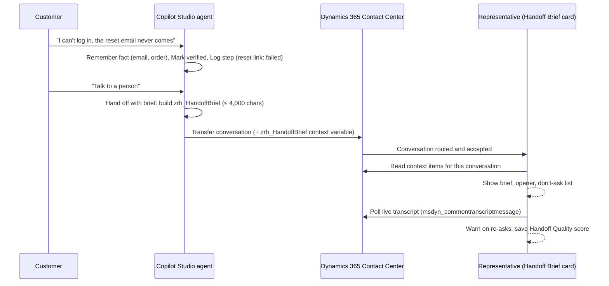

# Zero-Repeat Handoff

**When a Copilot Studio agent hands a customer to a person in Dynamics 365 Contact Center, the person should pick up exactly where the AI left off. This kit makes that happen, and measures it.**

> 96% of customer-service leaders say their AI-to-human handoffs keep context.
> 83% of customers say they still have to repeat themselves at least sometimes.
> — Five9 2026 research (Hanover Research, April 2026, 3,000 consumers and 600 business leaders in the US, UK and Germany)

Out of the box, the representative gets the raw handoff variables and a transcript to scroll through. Microsoft's own docs say *"AI agent conversations aren't automatically included in the conversation summary."* So the representative opens with "How can I help you today?", and the customer starts again.

## What's in the box

| Piece | What it does |
|---|---|
| **Handoff brief** (Copilot Studio topics) | Before the transfer, the agent writes one compact JSON brief: reason, goal, what the customer already told it, identity verification, what was tried and how it went, sentiment, urgency, a suggested next step and a suggested opening line. |
| **Handoff Brief card** (PCF control) | Sits on the conversation form in Copilot Service workspace and shows the brief: *"Already told the AI agent — don't ask again"*, a verified badge, what was tried, and a one-click opener. |
| **Live re-ask warning** | Watches the live transcript. If the representative asks for something the customer already gave ("Could you give me your order number?"), the card shows the value straight away. |
| **Handoff Quality score** | Scores every handoff 0–100 (re-asked facts, generic "how can I help" opener, customer saying "I already told the bot") and saves one row per conversation, so you can prove the fix works. |


## How it works



Two limits shape the design, and most teams discover them the hard way:

- A single context variable value is capped at **4,000 characters**. The brief topic shrinks itself to fit.
- All variables passed on transfer share a **28 KB** limit. Over it, the transfer still happens **but with no variables at all**. The brief topic clears its working variables before transferring.

## Repository layout

```
schema/              JSON Schema of the brief (handoff-brief.schema.json)
samples/             Example brief
copilot-studio/      Topics to paste into your agent (YAML) and how to wire them
pcf/HandoffBriefCard PCF control (React + Fluent UI v9), unit tests
scripts/             setup-dataverse.mjs: publisher, solution, Handoff Quality table, context variable
solution/            Exported Dataverse solution (managed + unmanaged)
docs/                Setup guide, architecture, demo script
```

## Quick start

Full steps are in **[docs/setup.md](docs/setup.md)**. In short:

1. You need an environment with Dynamics 365 Customer Service or Contact Center (the 30-day trial works) and a Copilot Studio agent connected to it.
2. Import `solution/ZeroRepeatHandoff_managed.zip`, or run `node scripts/setup-dataverse.mjs --url https://<org>.crm.dynamics.com` and push the control yourself.
3. Paste the four topics from [copilot-studio/](copilot-studio/) into your agent, and call the helpers where your topics collect facts or try things.
4. Add the **Handoff Brief Card** control to the conversation form used in Copilot Service workspace.
5. Start a chat, ask for a person, and accept the conversation.

Want to see it without any setup? Run the control in the PCF test harness and switch **Demo mode** on:

```bash
cd pcf/HandoffBriefCard && npm install && npm start
```

## Works without the brief too

If an agent doesn't send `zrh_HandoffBrief`, the card builds a basic brief from the variables every Copilot Studio handoff already carries (`va_LastPhrases`, `va_LastTopic`, `va_AgentMessage`, `va_Topics`, plus your topic variables). Dropping the control onto the form already helps; adding the topics makes it great.

## Status and limits

- The live re-ask warning reads `msdyn_commontranscriptmessage`, a per-message table Microsoft documented in September 2026. If your org doesn't populate it during the conversation, the card says the live check is unavailable and everything else keeps working.
- Copilot Studio can't insert text into the representative's reply box from a form control, so the opener and facts have Copy buttons.
- Built and tested against the standard (classic) Copilot Studio agent. The newer Customer Conversation harness (preview) has its own Escalate tool; support for it is on the roadmap.

## License

MIT. Not affiliated with or endorsed by Microsoft.
