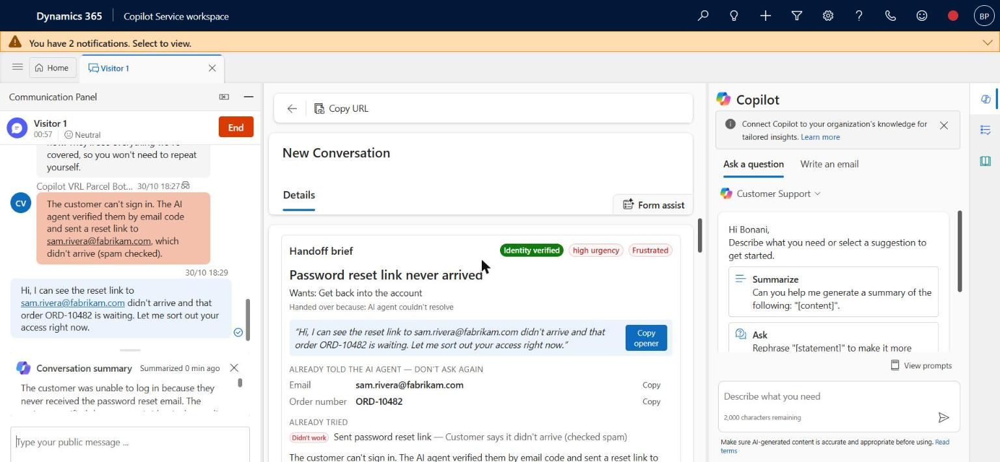
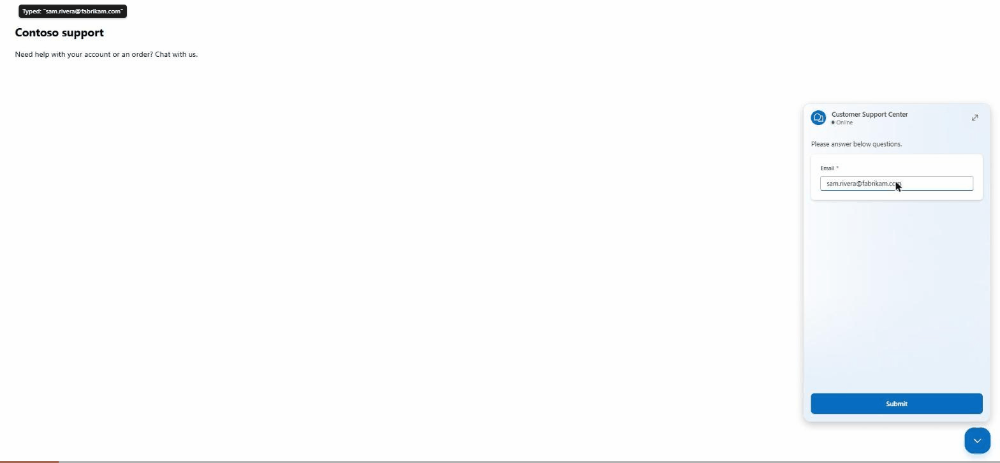
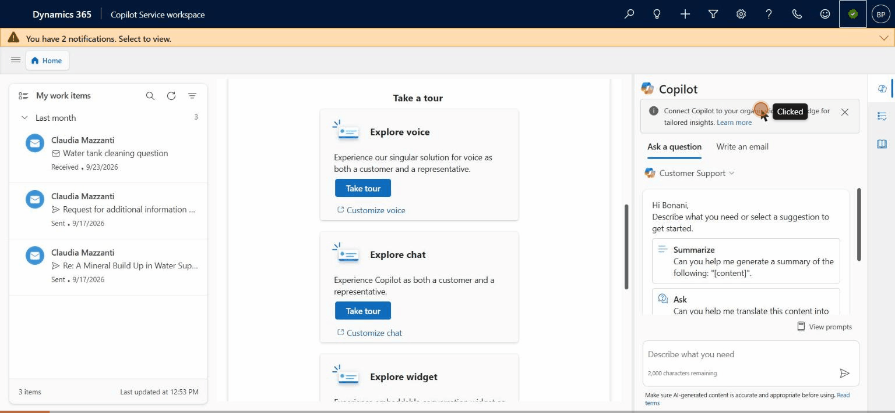
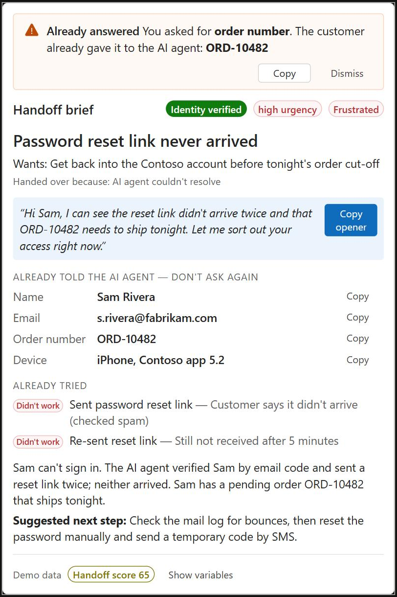
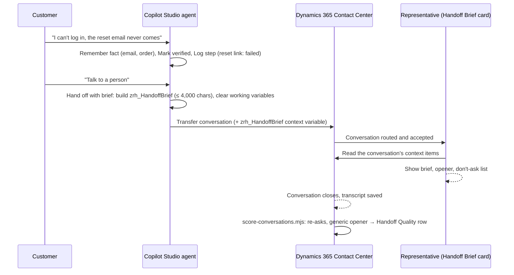

# Zero-Repeat Handoff

**When a Copilot Studio agent hands a customer to a person in Dynamics 365 Contact Center, the person should pick up exactly where the AI left off. This kit makes that happen, and measures it.**

> 96% of customer-service leaders say their AI-to-human handoffs keep context.
> 83% of customers say they still have to repeat themselves at least sometimes.
> — Five9 2026 research (Hanover Research, April 2026, 3,000 consumers and 600 business leaders in the US, UK and Germany)

Out of the box, the representative gets the transcript and, depending on configuration, a Copilot-written paragraph summary. A paragraph isn't a checklist: it doesn't say which facts the customer already gave, whether identity was verified, or what already failed, so representatives still open with "How can I help you today?" and re-ask for the order number. (Microsoft's docs even note that *"AI agent conversations aren't automatically included in the conversation summary"*; in our Contact Center trial they were, so check your own org.)



## Demo (recorded live in a Dynamics 365 Contact Center trial)

**1. The customer talks to the Copilot Studio agent and asks for a person.** The agent records the email and order number, verifies the customer, logs that the reset link failed, and hands off with a brief.



**2. The representative accepts, and the Handoff Brief card is already there.** One click copies an opener that proves the customer was heard, instead of "How can I help you today?".



## What's in the box

| Piece | What it does |
|---|---|
| **Handoff brief** (Copilot Studio topics) | Before the transfer, the agent writes one compact JSON brief: reason, goal, the facts the customer already gave, identity verification, what was tried and how it went, sentiment, urgency, a suggested next step and a suggested opening line. Facts and steps are recorded by your topics, never invented. |
| **Handoff Brief card** (PCF control) | Sits on the conversation form in Copilot Service workspace and shows the brief: *"Already told the AI agent — don't ask again"*, a verified badge, what was tried, and a one-click opener. |
| **Re-ask detection and Handoff Quality score** | Flags when the representative asks for something the customer already gave ("Could you give me your order number?"), a generic "how can I help" opener, or the customer saying "I already told the bot", and scores the handoff 0–100. Live in the card where the org fills the per-message transcript table; for every org, `scripts/score-conversations.mjs` scores closed conversations from the saved transcript. |
| **Scripts** | `setup-dataverse.mjs` (table, solution), `install-topics.mjs` (topics into an existing agent), `add-card-to-form.mjs` (card onto the conversation form), `score-conversations.mjs` (batch scoring). |



## How it works



## Lessons from the live test

Built and tested end to end in a Dynamics 365 Contact Center trial (October 2026): a real chat through the live chat widget, a Copilot Studio agent handing off, a representative accepting it in Copilot Service workspace with the card showing the brief, and the closed conversation scored (80/100: the representative re-asked for the order number). These are the things that broke, so they don't break for you:

- **Every variable travels.** On transfer, Copilot Studio sends *all* global and topic variables, and Dynamics 365 stores each one on the conversation. Working variables silently eat into the **28 KB** transfer limit (over it, the transfer happens **with no variables at all**). Clearing them before the transfer cut the stored payload for the same conversation from 5,016 to 2,967 characters. One context variable value is capped at **4,000 characters**; the brief shrinks itself to fit.
- **A variable whose text starts with `{` breaks the next topic that reads it** (`SystemError`, no details). The helpers store JSON fragments with a leading comma, and the brief gets its braces only in the final assignment.
- **The transfer's private message is a template, not a formula.** `messageToAgent: =Coalesce(...)` shows the representative the literal formula; use `"{Topic.AgentMessage}"`.
- **Topics created through the API need their global variables created too** (component type 12), or the agent fails at runtime. `install-topics.mjs` does both.
- **The enhanced conversation form can collapse its middle column**, so the card goes at the top of the left column.
- **The live per-message transcript table** (`msdyn_commontranscriptmessage`) stayed empty in our org. The card says so and stops polling; batch scoring from the saved transcript works everywhere.
- **In the saved transcript, the bot's messages are marked `isFromAgent: true` too.** They come from a user named "<agent> (Microsoft Copilot Studio)"; human messages carry a `public` tag. Count them as the representative and every handoff looks terrible.
- **The PCF platform library has to be one the org supports.** Fluent UI 9.68 was rejected at import; 9.46.2 works.

## Repository layout

```
schema/              JSON Schema of the brief (handoff-brief.schema.json)
samples/             Example brief
copilot-studio/      The topics (YAML) and how to install them
pcf/HandoffBriefCard PCF control (React + Fluent UI v9), shared scoring logic, unit tests
scripts/             setup-dataverse, install-topics, add-card-to-form, score-conversations
solution/            Exported Dataverse solution (managed + unmanaged) and unpacked source
docs/                Setup guide, screenshots
```

## Quick start

Full steps are in **[docs/setup.md](docs/setup.md)**. In short:

1. An environment with Dynamics 365 Customer Service or Contact Center (the 30-day trial works) and a Copilot Studio agent connected to it.
2. Import `solution/ZeroRepeatHandoff_managed.zip` (or run `setup-dataverse.mjs` and push the control).
3. `node scripts/install-topics.mjs --url https://<org>.crm.dynamics.com --bot <agent schema name> --escalate`, then publish the agent.
4. `node scripts/add-card-to-form.mjs --url https://<org>.crm.dynamics.com`
5. Start a chat, ask for a person, accept the conversation. Later, run `score-conversations.mjs`.

Want to see it without any setup? Run the control in the PCF test harness and switch **Demo mode** on:

```bash
cd pcf/HandoffBriefCard && npm install && npm start
```

## Works without the brief too

If an agent doesn't send `zrh_HandoffBrief`, the card builds a basic brief from the variables every Copilot Studio handoff carries (`va_LastPhrases`, `va_LastTopic`, `va_AgentMessage`, `va_Topics`, plus your topic variables). Dropping the control onto the form already helps; adding the topics makes it great.

## Status and limits

- Copilot Studio can't insert text into the representative's reply box from a form control, so the opener and facts have Copy buttons.
- Re-ask detection is phrase-based (it knows how people ask for emails, order numbers, account numbers...). Give a fact custom `ask` phrases in the brief for anything unusual.
- Built for the standard (classic) Copilot Studio agent, with or without generative orchestration. The newer Customer Conversation harness (preview) has its own Escalate tool; support for it is on the roadmap.

## License

MIT. Not affiliated with or endorsed by Microsoft.
