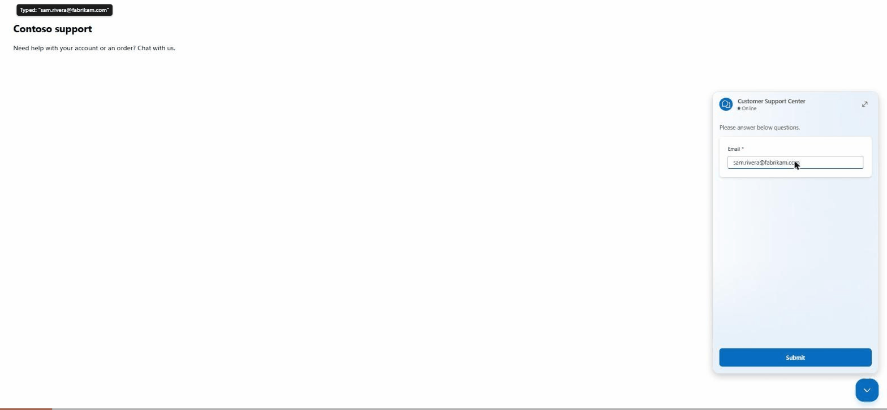
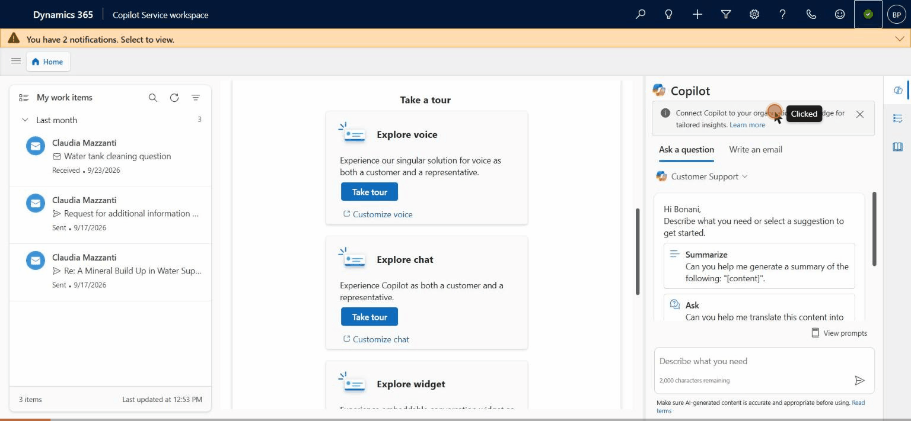
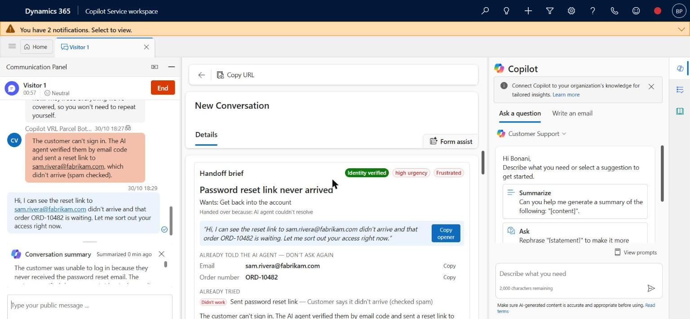
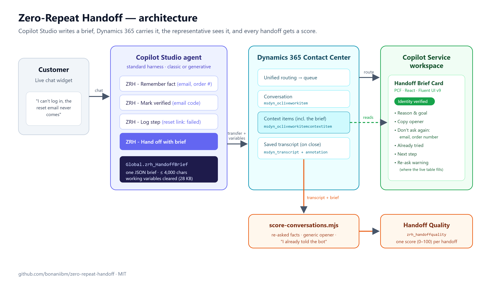
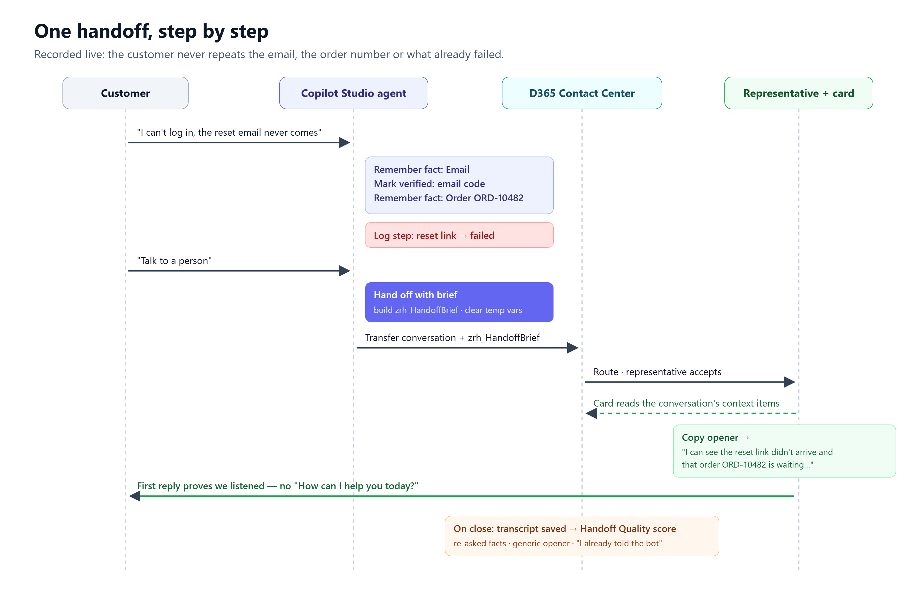

# Your AI agent did the work. Then your human agent asked "How can I help you today?"

### An open-source kit for Copilot Studio and Dynamics 365 Contact Center so customers never repeat themselves — and the seven things that broke when I tested it for real.

Picture the chat. A customer can't sign in. Your Copilot Studio agent does everything right: it asks for the email, verifies the customer with a one-time code, notes the order that has to ship tonight, sends a reset link, and listens when the customer says the link never arrived. Then the customer types "talk to a person".

The person picks up and writes: *"Hi, how can I help you today?"*

Everything the AI agent learned is technically somewhere — in a transcript, in a dozen context variables — but nothing on the representative's screen says *"you already know the email, the customer is verified, the reset link failed twice, don't ask again"*. So the customer repeats themselves, and the AI agent that was supposed to make service better has made the handoff feel worse.

## The numbers say this is everyone's problem

In April 2026, Five9 and Hanover Research surveyed 3,000 consumers and 600 business leaders in the US, UK and Germany. **96% of the leaders said their organization preserves context during AI-to-human handoffs. 83% of consumers said they still have to repeat themselves at least sometimes after being transferred.**

That gap is the whole story. Leaders see a transfer that "worked". Customers feel a conversation that started over.

## What you get out of the box

Dynamics 365 Contact Center already does a lot here: the representative sees the transcript, and Copilot can write a paragraph summary when they join. Microsoft's own docs note that *"AI agent conversations aren't automatically included in the conversation summary"*; in my trial org they were included — so check yours.

But a paragraph isn't a checklist. It doesn't tell the representative which facts the customer already gave, whether identity was verified, or what already failed. That's what representatives actually need at second zero of a handoff.

## What I built: Zero-Repeat Handoff

An open-source kit (MIT) with three pieces:

1. **A handoff brief, written by the Copilot Studio agent.** Four small topics record facts the customer gives (*Remember fact*), what the agent tried and how it went (*Log step*), identity verification (*Mark verified*), and finally build one compact JSON brief right before the transfer (*Hand off with brief*). Facts are recorded by your topics, never invented by a model.
2. **The Handoff Brief Card**, a PCF control (React + Fluent UI v9) on the conversation form in Copilot Service workspace. It shows the reason, an "Identity verified" badge, a *don't ask again* list with copy buttons, what was already tried, a suggested next step — and a one-click opener that proves the customer was heard.
3. **A Handoff Quality score.** Every closed conversation gets a 0–100 score: did the representative re-ask for a fact the AI already had, open with a generic "how can I help", or did the customer say "I already told the bot"? That's the number the 96% aren't measuring.

👉 **Repo: https://github.com/bonaniibm/zero-repeat-handoff**

## The demo (recorded live)

This was recorded in a real Dynamics 365 Contact Center trial: a real chat widget, a real Copilot Studio agent, a real representative in Copilot Service workspace.

**The customer talks to the AI agent and asks for a person:**



**The representative accepts — and the brief is already there. One click copies the opener:**





## Architecture



The agent writes one global variable, `zrh_HandoffBrief`. On transfer, Copilot Studio passes it to Dynamics 365, which stores it on the conversation as a context item (`msdyn_ocliveworkitemcontextitem`). The card reads the context items for the conversation it sits on. When the conversation closes, Dynamics 365 saves the transcript, and a scoring script turns transcript + brief into one row in a `zrh_handoffquality` table.

## One handoff, step by step



This is the brief from that exact recorded conversation:

```json
{
  "v": 1,
  "reason": "Password reset link never arrived",
  "verified": { "status": "verified", "method": "Email one-time code" },
  "facts": [
    { "k": "Email", "v": "sam.rivera@fabrikam.com" },
    { "k": "Order number", "v": "ORD-10482" }
  ],
  "tried": [
    { "step": "Sent password reset link", "outcome": "failed",
      "note": "Customer says it didn't arrive (checked spam)" }
  ],
  "sentiment": "negative",
  "urgency": "high",
  "next": "Check the mail log for bounces, then reset the password manually and send a temporary code by SMS.",
  "opener": "Hi, I can see the reset link to sam.rivera@fabrikam.com didn't arrive and that order ORD-10482 is waiting. Let me sort out your access right now."
}
```

With generative orchestration on, the orchestrator fills the narrative parts (reason, summary, opener) from the conversation. With classic orchestration, your topics set them. Either way, the facts come only from what your topics recorded.

## Seven things that broke when I tested it for real

Building it was the easy part. Running it end to end in a real org is where the lessons were. If you build anything on Copilot Studio → Dynamics 365 handoff, these will save you a day:

**1. Every variable travels.** On transfer, Copilot Studio sends *all* global *and* topic variables, and Dynamics 365 stores each one on the conversation. Your working variables silently eat into the 28 KB transfer limit — and above it, the transfer still happens *with no variables at all*. Clearing temporary variables before the transfer cut the stored payload for the same conversation from **5,016 to 2,967 characters**. (One context variable is also capped at 4,000 characters; the brief shrinks itself to fit.)

**2. A variable whose text starts with "{" breaks the next topic that reads it.** No details, just `SystemError`. I found it by bisecting with a throwaway debug topic. The fix: store JSON fragments with a leading comma and add the outer braces only in the final assignment.

**3. The transfer's private message is a template, not a formula.** I wrote `messageToAgent: =Coalesce(...)` and the representative saw the literal formula in a red bubble. Use `"{Topic.AgentMessage}"`.

**4. Topics created through the API need their global variables created too.** The Copilot Studio editor quietly creates a component for each global variable when you save. Create topics through the Dataverse API and skip that, and the agent fails at runtime. The repo's installer does both.

**5. The enhanced conversation form can collapse its middle column.** My card rendered perfectly — inside a column that wasn't on screen. It lives at the top of the left column now.

**6. The live per-message transcript table stayed empty.** Dynamics 365 documents a per-message table (`msdyn_commontranscriptmessage`) that would allow a live "you're re-asking" warning. In my org it never filled, so the card says so and stops polling, and scoring runs on the saved transcript after the conversation closes — which works everywhere.

**7. In saved transcripts, the bot's messages are marked as agent messages too.** They come from a user named "<agent> (Microsoft Copilot Studio)"; human messages carry a `public` tag. My first score counted the bot's "How can I help?" against the representative and came out at 45. With roles fixed: **80/100** — the representative in my test did re-ask for the order number, and the score caught it.

(Bonus: the PCF platform library has to be one the org supports. Fluent UI 9.68 was rejected at import; 9.46.2 works.)

## Try it in an afternoon

You need an environment with Dynamics 365 Customer Service or Contact Center (the 30-day trial works) and a Copilot Studio agent connected to it.

```bash
# 1. table + solution (or import solution/ZeroRepeatHandoff_managed.zip)
node scripts/setup-dataverse.mjs --url https://<org>.crm.dynamics.com
# 2. topics + global variables into your agent, Escalate pointed at the brief
node scripts/install-topics.mjs --url https://<org>.crm.dynamics.com --bot <agent schema name> --escalate --publish
# 3. the card on the Active Conversation form
node scripts/add-card-to-form.mjs --url https://<org>.crm.dynamics.com
# 4. score closed conversations
node scripts/score-conversations.mjs --url https://<org>.crm.dynamics.com --days 7
```

Just want to see the card? `cd pcf/HandoffBriefCard && npm install && npm start` and switch on **Demo mode** in the test harness.

Full setup guide: https://github.com/bonaniibm/zero-repeat-handoff/blob/main/docs/setup.md

## What's next

Microsoft is pushing hard here: real-time voice agents in Copilot Studio, the new Customer Conversation harness, and Contact Center Intelligence (public preview, October 2026) all promise "full context" on escalation. I want to run the same Handoff Quality score against those and see whether a transfer that carries the transcript really means a customer who doesn't repeat themselves.

If you run Copilot Studio in front of human agents, measure your handoffs. The 83% won't show up in your containment dashboard.

⭐ **Star or fork it: https://github.com/bonaniibm/zero-repeat-handoff** — issues and PRs welcome.

---

*Sources: Five9 2026 Consumer and Business CX research (Hanover Research, April 2026); Microsoft Learn — "Enable Copilot case and conversation summaries", "Hand off to a live agent", "Configure context variables for agents". Not affiliated with or endorsed by Microsoft.*
